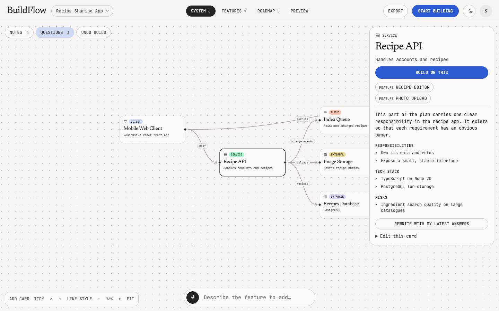
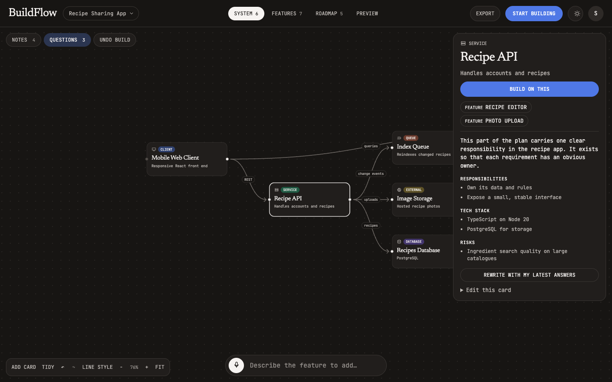
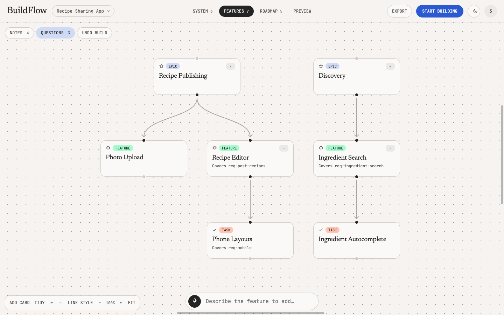
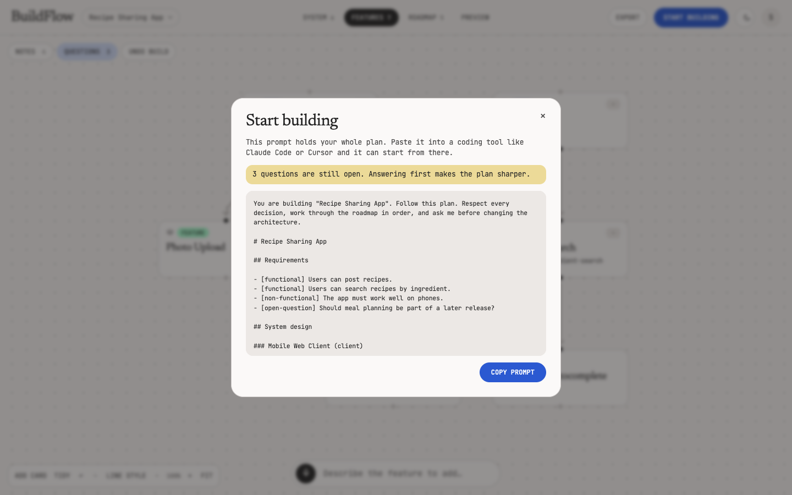

# BuildFlow

[](https://github.com/Hanart-prog/buildflow-ai/actions/workflows/ci.yml)
[](LICENSE)

Talk through a software idea and watch the plan draw itself: a system-design diagram, a feature hierarchy and a roadmap, all on interactive canvases. Plan a whole product from scratch, or add one feature to a plan you already have.

It runs on your own machine with a free Groq key, and when the plan is ready it hands everything to your coding tool in one prompt.


| A plan and a card's spec | Dark mode |
| --- | --- |
|  |  |

| Feature breakdown | Ready for a coding tool |
| --- | --- |
|  |  |

## How it works

1. **Capture.** The browser records your voice and Whisper transcribes it. You can review or type the text before generating, and choose **Whole product** or **One feature**.
2. **Extract.** The first LLM stage pulls structured requirements out of the rambling speech and flags open questions.
3. **Map.** The second stage turns those requirements into three linked boards and maps the dependencies between nodes. Requirements stream to the page as soon as they are ready, then each node and edge lands on the canvas while the model is still writing it, and nodes glide into place as connections arrive.
4. **Answer.** Each description can bring up to three follow-up questions about that description, one at a time. Answers become decisions that every later build and node detail follows, and are kept with the requirements under **Notes**.
5. **Go deeper.** Click any card for a full spec: responsibilities, tech stack, data, risks or acceptance criteria. Specs are written the first time a card is opened and saved with it.
6. **Preview.** The Preview tab designs the product's three most important screens as concept mockups, drawn live from the plan. Model-written HTML runs in a sandboxed iframe with no scripts or network access.
7. **Edit.** Rename, move, connect, add or delete anything, with undo and redo. Changes save automatically to PostgreSQL.
8. **Start building.** Copy the whole plan as one prompt for a coding tool like Claude Code or Cursor.

Already built something? Drop its folder on the start screen and BuildFlow maps what exists, so you can add features to it. Only text files are read, up to 14,000 characters, and they are sent to the AI provider. `.env` files, keys, lockfiles and anything named like a secret are skipped, but check a project for secrets inside ordinary files before dropping it.

To grow one part of a plan, open a card and choose **Build on this**. The new work is drawn on that board and connected to that card.

Talking again extends the same plan. Generation only ever adds to it: the merge step in `server/src/pipeline.ts` keeps every existing node, edge and position, so your hand edits survive. The streamed items are only a preview: the finished reply is still schema-validated, retried once with the error fed back, stripped of edges that point at nodes that don't exist, and is what gets saved.

## Working with a plan

- **Linked boards:** open a card to jump to the system parts, features and roadmap steps tied to it.
- **Cleaner boards:** collapse a branch on the Features board, or switch to square lines.
- **Export:** download the plan as Markdown.
- **Projects:** new projects are named by the AI, can be renamed from the project menu, and are listed on your home screen.
- **Undo build:** return to the plan from before the last build. A failed build offers **Try again**.
- **View-only links:** anyone with the link can read the plan. Turn the link off from the same menu.

## Stack

React, TypeScript, [FlowGram](https://github.com/bytedance/flowgram.ai), Vite, Node.js, Express, PostgreSQL (embedded through PGlite, so there is nothing to install), Groq or OpenAI API.

## Run it

Requires Node 20 or newer.

```sh
git clone https://github.com/Hanart-prog/buildflow-ai.git
cd buildflow-ai
npm install
cp .env.example .env   # add GROQ_API_KEY (free) or OPENAI_API_KEY
npm run dev            # http://localhost:5173
```

Get a free Groq key at https://console.groq.com/keys. If both keys are set, Groq is used.

To try it without a key, set `DEMO_MODE=true` in `.env`. The real pipeline then runs on canned model replies, so every idea gives the same sample plan.

Sign up the first time you open it. Your account and plans stay in `server/data` on your machine, and each account only sees its own projects.

```sh
npm test
npm run typecheck
```

## Run it for other people

Use `npm start`, which builds the client and serves it from the API on `PORT`. A host needs a persistent disk for `server/data`.

- Anyone who can reach the app can create an account and spend your AI key. Set `APP_PASSWORD` to put a shared password in front of everything. View-only links work without a login or that password.
- Each account gets `DAILY_BUILDS` builds and previews a day, 20 by default.
- There is no password reset yet.

## License

[MIT](LICENSE)
